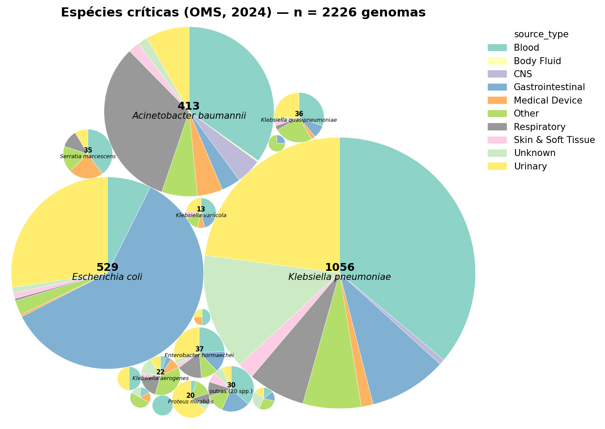
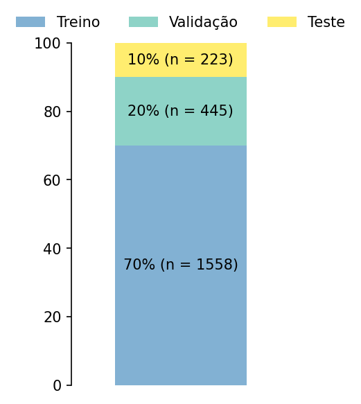

# Python para Machine Learning

**Aluno:** Rodrigo A. Lusa - Mestrado 
**Professor:** Guilherme F. Silveira (https://github.com/Laboratorio-de-Analise-de-Dados/disciplina_python_ml)

## Pré-processamento

Os genomas bacterianos utilizados neste estudo foram obtidos, em 03/02/2026, a partir
de dois repositórios públicos: BV-BRC v3.58.4 ([BV-BRC](https://www.bv-brc.org/)) e
NCBI Pathogen Detection ([NCBI-Pathogens](https://www.ncbi.nlm.nih.gov/pathogens/)).
No BV-BRC, foram aplicados os filtros de origem geográfica (Brasil), hospedeiro humano
e classificação de qualidade "good", resultando em 4.310 genomas. No NCBI Pathogen
Detection, foram aplicados os filtros de origem geográfica (Brasil) e hospedeiro
humano, resultando em 6.646 genomas. Após a padronização dos metadados (ano de coleta,
espécie e fonte de isolamento) e remoção de duplicatas (mesmo `Assembly_id`) entre as
duas bases, obteve-se um total de 7.068 isolados bacterianos brasileiros únicos.

- **NCBI Datasets** (v18.16.0) - download
- **Prodigal** (v2.6.3) — predição de genes codificadores de proteína
- **RGI** (v6.0.5) — identificação de genes de resistência antimicrobiana, usando o banco de dados CARD (v4.0.1)
- **geNomad** (v1.12.0) — classificação de contigs em cromossomal ou plasmidial

Foram filtrados apenas os genomas de espécies ou gêneros listados pela OMS (2024) como de
nível crítico.

  

Divisão estratificada por espécie (espécies com < 20 genomas agrupadas em "outras"):

  

## App

O app do Streamlit traz as etapas de pré-processamento, clustering, classificação e
regressão: [Abrir o app](LINK_DO_APP)
